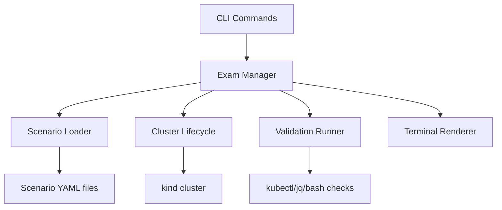

# k8s-exam-simulator

Original Kubernetes practice exam simulator for CKS, CKA, and CKAD using local kind clusters.

## Features

- Single-binary Go CLI built with Cobra
- Exam and single-scenario practice modes
- Original YAML-backed scenarios with setup, hints, validation, and solutions
- kind cluster lifecycle management per exam type
- Terminal-friendly task, status, timer, and validation rendering via Lip Gloss / Bubble Tea
- Persistent local session state in `.k8s-exam-state/session.yaml`

## Prerequisites

- Go 1.23+
- Docker
- kind
- kubectl
- jq
- bash

## Installation

```bash
go mod tidy
go build -o k8s-exam
```

## Usage

```bash
./k8s-exam list
./k8s-exam list --verbose
./k8s-exam list --exam cks --verbose
./k8s-exam list --domain "Cluster Hardening"
./k8s-exam start cks
./k8s-exam start cks --no-timer
./k8s-exam task
./k8s-exam validate
./k8s-exam hint
./k8s-exam skip
./k8s-exam status
./k8s-exam reset
./k8s-exam scenario multi-container-pod
./k8s-exam scenario multi-container-pod --no-timer
```

## Exam flow

1. Start an exam or a single scenario.
2. The tool validates prerequisites and creates a kind cluster.
3. The current scenario setup script prepares the cluster.
4. Solve the task with normal Kubernetes tooling.
5. Run `validate` for pass/fail feedback.
6. Review progress with `status` until all tasks are complete.

`start` prints the first task. Run `task` any time to reprint the current one,
including its description, context and your remaining time.

## Scoring

Each scenario carries a weight taken from the certification blueprint, so the
five scenarios in a track sum to roughly a third rather than 100. `Score` is
normalised against the weight available in the session, which means passing
everything reports 100% whether you ran a full exam or a single scenario.

Exam and practice sessions share one kind cluster per track, named
`kind-<exam>-exam`, because scenario validation scripts address nodes by that
name. Only one session exists at a time, so run `reset` before switching.

## Untimed practice

Pass `--no-timer` to `start` or `scenario` and the countdown is replaced with
`∞ (no timer)` in both the task panel and `status`. Everything else behaves the
same, so validation, hints, skipping and scoring all still work.

The timer has never gated anything. Even in a timed session it is a display
only, and `validate` keeps working after it hits zero, where the clock then
reads `00:00:00 (time expired)`. Use `--no-timer` when you want that pressure
gone from the screen entirely.

## Previewing scenarios

`list --verbose` prints every task description and its domains. On its own it
covers all three tracks:

```bash
./k8s-exam list --verbose
```

Two filters narrow it. `--exam` picks one track, and `--domain` matches on
curriculum area with a case-insensitive substring, so `--domain hardening`
catches both `Cluster Hardening` and `System Hardening`:

```bash
./k8s-exam list --exam cks --verbose
./k8s-exam list --domain scheduling --verbose
./k8s-exam list --exam cka --domain storage
```

They combine, and a domain that matches nothing exits non-zero listing the
domains that do exist in whatever exam you scoped to.

Every list ends with a total, which is what makes `--domain` useful for
planning revision:

```
cks:
  - audit-logging [hard, 8%, 12min]
  - network-policy-deny-all [medium, 7%, 10min]
  - pod-security-standards [medium, 6%, 8min]
  - rbac-least-privilege [medium, 7%, 10min]
  total: 28% across 4 scenarios, ~40min
```

This deliberately omits hints and solutions, so you can see what a track covers
before committing to it without spoiling the tasks. Reading the YAML under
`scenarios/` directly does spoil them: each file carries its validation script
and a working solution alongside the description.

## Project structure

- `cmd/`: Cobra command definitions
- `internal/exam/`: session state, scenario loading, and orchestration
- `internal/cluster/`: kind configs and cluster lifecycle helpers
- `internal/validator/`: shell-based validation runner
- `internal/ui/`: terminal rendering helpers
- `scenarios/`: original scenario definitions for CKS, CKA, and CKAD

## Architecture



## Notes

- Scenarios are original practice exercises derived from public Kubernetes documentation and curriculum domains.
- Validation scripts are intended for kind-based local practice and may require Linux/macOS-compatible shells.
- Use `reset` after each session to tear down the cluster cleanly.

## Writing scenario scripts

Setup, validation and solution scripts run with `set -euo pipefail` and two
variables exported for you:

| Variable | Value |
| --- | --- |
| `KIND_CLUSTER_NAME` | the cluster backing the current session, such as `kind-cka-exam` |
| `KUBECONFIG` | kubeconfig path for that cluster |

Never hardcode a cluster or node name. Address nodes through the variable:

```bash
docker exec "${KIND_CLUSTER_NAME}-control-plane" ls /etc/kubernetes
docker exec "${KIND_CLUSTER_NAME}-worker" mkdir -p /var/local-path/app-data
```

`TestNoHardcodedClusterNames` in `internal/exam/manager_test.go` fails the build
if a literal `kind-ck*-exam-*` name creeps back in. The `context:` block is
display text only, so a literal cluster name is fine there.

## Contributing

1. Add or update scenario YAML files.
2. Keep setup scripts idempotent.
3. Address nodes as `${KIND_CLUSTER_NAME}-control-plane`, never a literal name.
4. Ensure `go build ./...` and `go test ./...` succeed before opening a PR.
